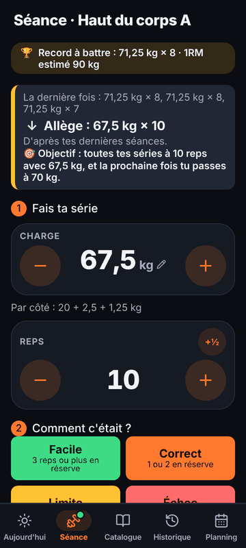
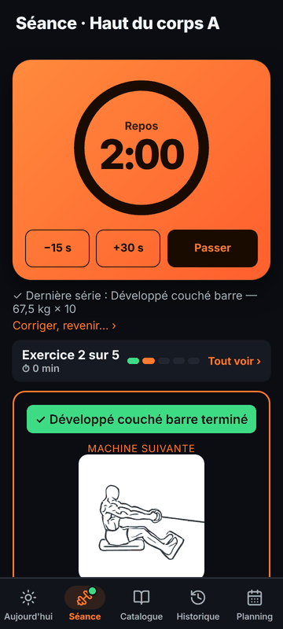
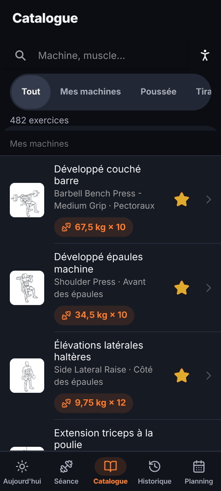
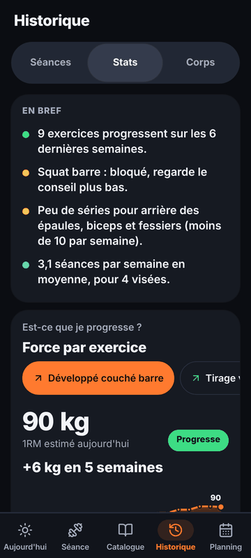
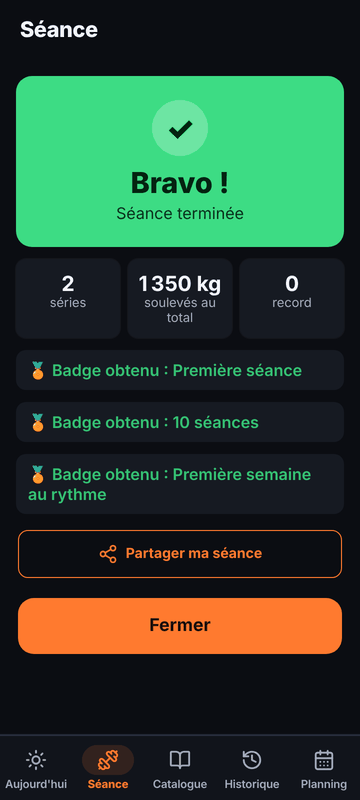

<div align="center">

# 🏋️ Trainerr

**Ton coach de muscu de poche.**
L'appli te dit quelle séance faire, quelle charge mettre sur chaque machine,
et ajuste la suite à chaque série. Tout reste sur ton téléphone.

[Fonctionnalités](#-fonctionnalités) ·
[Installer](#-installer-et-lancer) ·
[iOS](#-construire-pour-ios) ·
[Contribuer](CONTRIBUTING.md) ·
[Sources et crédits](#-sources-et-crédits) ·
[Licence](#-licence)

<br>








</div>

---

## ✨ Fonctionnalités

### À la salle

- **Une séance prête chaque jour** selon ton objectif, ton rythme et tes machines favorites. Pas assez de favoris ? L'appli propose une **pré-séance** avec des machines courantes.
- **Aperçu avant de partir** : exercices, séries, charges, durée estimée et où tu montes en charge. **« Pas en forme »** allège la séance du jour au lieu de la sauter.
- **Séances types à copier et modifier** (Push, Pull, Jambes…) pour en faire les tiennes.
- **Le bon poids à chaque série** : « La dernière fois : 20 kg × 10 » puis un conseil clair (monte la charge, vise une rep de plus, garde, allège) et sa raison. Les paliers réels de chaque machine sont respectés, sans plafond pour les plus forts. Tu t'entraînes déjà ? Note tes **charges habituelles** au lieu de faire des séries test.
- **Pendant l'effort** : objectif de progression, disques à mettre de chaque côté de la barre, temps écoulé, minuteur de repos visible écran verrouillé. Les tractions assistées se comptent à l'envers (moins d'aide = progrès).
- **Saisie en deux gestes** : charge et reps déjà remplies, un appui sur le ressenti (Facile, Correct, Limite, Échec) enregistre et lance le repos.
- **Rien n'est figé** : corriger une série validée trop vite, revenir à l'exercice précédent, ajouter une série, ajouter un exercice depuis le **programme de la séance**, changer l'ordre, séparer un superset.
- **Tous les muscles sur la semaine** : chaque séance choisit en priorité les exercices des muscles qui ont eu moins de 10 séries sur les 7 derniers jours, et l'aperçu dit lesquels elle rattrape.
- **Machines très proches** : depuis l'aperçu, remplace une machine par une autre du même mouvement (le choix est gardé pour les séances suivantes) ; pendant la séance, les plus proches sont proposées sous l'exercice avant la première série.
- **Machine occupée** : alternatives avec aperçu (dessin, muscles, charge), la machine est reproposée plus tard.
- **Changement de machine visible** : « ✓ Terminé · Machine suivante » avec le dessin du mouvement.
- **Supersets en option**, séance express, séance à la maison, **séances personnalisées**.

### Pour progresser

- **Catalogue de 480 exercices** avec dessins du mouvement, muscles travaillés, consignes en français, **recherche par zone du corps** et ta charge sur chaque machine.
- **Statistiques** : régularité, évolution de la force (1RM estimé), séries par muscle, records.
- **Récap de fin de séance** : volume gagné depuis la dernière fois, durée, records, et une image à partager.
- **Historique modifiable**, avec trophées sur les records. Téléphone oublié ? **Ajoute après coup une séance faite sans l'appli** : elle compte dans les stats et le cycle.
- **Suivi du poids du corps** (Historique → Corps) : pesée du jour ou d'une date passée, courbe sur 3 mois et tendance par semaine, mensurations et photo du mois. Tes pesées faites ailleurs s'importent en CSV ([docs/import.md](docs/import.md#mes-pesées)).
- Badges, récap du mois à partager.
- **Défis entre amis** et **conseils d'un coach IA**, optionnels, via un petit serveur ([server/](server/README.md)).

### Pour tous

- **Hors ligne d'abord** : base SQLite sur le téléphone, aucune donnée envoyée sans action de ta part (RGPD).
- **Français et anglais**, kilos ou livres, thème clair et sombre, grandes zones tactiles.
- Export (via le menu Partager d'Android), import (Strong, Hevy, tes séances, tes charges ou tes pesées en CSV : [docs/import.md](docs/import.md)), sauvegarde chiffrée et suppression complète en un bouton.
- **Mises à jour intégrées** sur Android : l'appli trouve toute seule la nouvelle version (au démarrage et quand tu y reviens) et l'installe avec ton accord ([docs/mises-a-jour.md](docs/mises-a-jour.md)). La page **Nouveautés** des Réglages dit ce qui change à chaque version.
- **Envoyer un retour** depuis les Réglages : ça ouvre ton appli mail avec un message prérempli (version de l'appli, téléphone, langue). Rien n'est envoyé sans toi.

## 🚀 Installer et lancer

Prérequis : [Node.js](https://nodejs.org) 24 ou plus récent.

```sh
npm install
npm run dev
```

Vite affiche deux adresses :

- **Local** (`http://localhost:5173`) pour l'ordinateur ;
- **Network** (par exemple `http://192.168.1.20:5173`) pour le **téléphone**, connecté au même Wi-Fi. Ouvre-la dans Chrome ou Safari.

## 📱 Installer sur Android

**La version publiée** : chaque merge sur `main` publie un APK signé dans les [Releases GitHub](https://github.com/Happy4Game/Trainerr/releases/latest) (workflow **Publier l'APK**). Installe-le une fois ; ensuite l'appli te propose elle-même les nouvelles versions.

**Un APK de test sans rien installer** : le workflow **Android APK** construit aussi un APK de debug à chaque push, dans l'onglet **Actions**, artefact `trainerr-debug-apk`.

### Générer l'APK sur ton ordinateur

1. Installe le **JDK 21** ([Temurin](https://adoptium.net)) et le **SDK Android 36** (via [Android Studio](https://developer.android.com/studio), ou les outils en ligne de commande : voir [docs/android.md](docs/android.md)).
2. Indique où ils sont :

   ```sh
   export JAVA_HOME=~/.local/jdk-21        # dossier du JDK 21
   export ANDROID_HOME=~/Android/Sdk       # dossier du SDK Android
   echo "sdk.dir=$ANDROID_HOME" > android/local.properties
   ```

3. Génère l'APK :

   ```sh
   npm run android:export
   ```

   La commande compile l'appli, la copie dans le projet Android, construit l'APK et le dépose dans **`exports/trainerr-<version>-debug.apk`**.

4. Installe-le sur le téléphone : envoie le fichier (mail, cloud, câble) et ouvre-le en autorisant l'installation depuis cette source, ou, téléphone branché en débogage USB :

   ```sh
   $ANDROID_HOME/platform-tools/adb install -r exports/trainerr-*-debug.apk
   ```

Autres commandes : `npm run android:apk` (APK dans `android/app/build/outputs/apk/debug/`), `npm run android:sync` (met à jour le projet Android après un changement), `npx cap open android` (ouvre Android Studio).

> C'est un APK **de test**, signé avec une clé de debug. Pour le Play Store, il faut une clé de signature personnelle : la marche à suivre est dans [docs/android.md](docs/android.md#version-de-production-play-store).

## 🍎 Construire pour iOS

L'appli se compile aussi pour iPhone, **sans compte Apple Developer payant** (elle n'est pas sur l'App Store). Le workflow **iOS** tourne sur un Mac de GitHub Actions, gratuit pour un dépôt public, à chaque push et pull request. Dans l'onglet **Actions**, il dépose deux artefacts :

- `trainerr-ios-simulator` : l'appli pour le simulateur d'iPhone d'Xcode ;
- `trainerr-ios-unsigned-ipa` : un `.ipa` **non signé**, à signer avant de l'installer sur un iPhone.

Pour l'installer sur ton iPhone avec un compte Apple gratuit (via Xcode sur un Mac, à refaire tous les 7 jours) et voir ce qui diffère d'Android : [docs/ios.md](docs/ios.md). Commandes : `npm run ios:sync` (met à jour le projet iOS), `npx cap open ios` (ouvre Xcode).

## 🧪 Tests et qualité

| Commande                | Ce qu'elle vérifie                                                 |
| ----------------------- | ------------------------------------------------------------------ |
| `npm test`              | Tests unitaires : règles métier, migrations de la base, serveur    |
| `npm run test:coverage` | Pareil, avec la couverture (seuil : 90 % des lignes du domaine)    |
| `npm run test:e2e`      | Parcours complets dans un vrai navigateur (Playwright)             |
| `npm run lint`          | Style et erreurs courantes (ESLint, Prettier)                      |
| `npm run typecheck`     | Types TypeScript                                                   |
| `npm run check:i18n`    | Traductions : mêmes clés dans chaque langue, aucune clé inutilisée |
| `npm run check`         | Tout ce qui précède sauf les tests de bout en bout                 |

Playwright peut utiliser un Chromium déjà installé : `CHROMIUM_PATH=/usr/bin/brave npm run test:e2e`. Sinon, `npx playwright install chromium` télécharge le sien.

Un hook Git (Husky) lance le lint, les types, les traductions et les tests avant chaque commit, et la CI GitHub Actions refait tout, tests de bout en bout compris, à chaque pull request.

## 🧱 Comment c'est construit

[Ionic](https://ionicframework.com) + [Vue 3](https://vuejs.org) + [Capacitor](https://capacitorjs.com), TypeScript strict, SQLite sur le téléphone. Les projets natifs sont dans `android/` et `ios/`.

| Dossier                 | Contenu                                                                                                 |
| ----------------------- | ------------------------------------------------------------------------------------------------------- |
| `src/domain/`           | Règles métier en TypeScript pur : progression, planning, stats… Aucune dépendance à Vue, Ionic, SQLite. |
| `src/data/`             | Base SQLite, migrations, catalogue, traductions des consignes.                                          |
| `src/views/`, `src/ui/` | Écrans et composants Vue / Ionic, sans règle métier.                                                    |
| `src/i18n/`             | Textes de l'interface, un fichier par langue.                                                           |
| `server/`               | Serveur optionnel (défis entre amis, conseils IA).                                                      |
| `tests/`, `e2e/`        | Tests unitaires (Vitest) et de bout en bout (Playwright).                                               |
| `docs/adr/`             | Les décisions techniques et leurs raisons.                                                              |

Pour aller plus loin : le cahier des charges [SPEC.md](SPEC.md), l'avancement [PROGRESS.md](PROGRESS.md) et les [décisions techniques](docs/adr/).

## 📚 Sources et crédits

Tout ce que l'appli embarque a une licence connue ; la page **Crédits** de l'appli liste chaque ressource, chaque auteur et le texte de chaque licence.

| Ressource                                                       | Usage                                     | Licence                                 |
| --------------------------------------------------------------- | ----------------------------------------- | --------------------------------------- |
| [free-exercise-db](https://github.com/yuhonas/free-exercise-db) | Catalogue : exercices, muscles, consignes | Domaine public (Unlicense)              |
| [Everkinetic](https://github.com/everkinetic/data)              | Dessins du mouvement (départ et arrivée)  | CC BY-SA 4.0                            |
| [wger](https://wger.de)                                         | Quelques dessins complémentaires          | CC BY-SA (auteur noté sur chaque fiche) |
| [MuscleMapJS](https://github.com/abdofallah/MuscleMapJS)        | Silhouettes des muscles                   | MIT                                     |
| [Lucide](https://lucide.dev)                                    | Icônes et logo de l'appli (l'haltère)     | ISC                                     |
| Ionic, Vue, Capacitor et les autres bibliothèques               | Code de l'appli                           | MIT, ISC, BSD, Apache 2.0               |

Les règles d'entraînement (fourchettes de reps, volume par muscle, progression, repos) s'appuient sur des publications citées dans l'appli (onglet **Bien débuter**) et dans [SPEC.md](SPEC.md). Les consignes traduites sont une traduction automatique, signalée comme telle sur chaque fiche, avec le texte original à la demande.

Les captures d'écran ci-dessus contiennent des dessins Everkinetic (CC BY-SA 4.0).

## 🤝 Contribuer

Les contributions sont les bienvenues : lis [CONTRIBUTING.md](CONTRIBUTING.md) pour l'installation, les règles de code, les tests attendus et le déroulé d'une pull request. Une pull request qui change ce que voit l'utilisateur ajoute une ligne à la page Nouveautés ([src/data/content/changelog.ts](src/data/content/changelog.ts), textes dans `changelog.items` des traductions).

## ⚖️ Licence

Le code de Trainerr est publié sous la licence [PolyForm Noncommercial 1.0.0](LICENSE.md) :

- ✅ tu peux **lire, utiliser, modifier et partager** le code, et faire un fork, pour un usage personnel, l'étude, la recherche, une association ou un établissement d'enseignement ;
- ❌ tu ne peux **pas t'en servir commercialement** : vendre l'appli ou un fork, la publier payante ou avec de la publicité, l'intégrer à un produit ou un service payant ;
- chaque copie doit garder le fichier [LICENSE.md](LICENSE.md) et sa ligne `Required Notice`.

Ce n'est donc pas une licence « open source » au sens de l'OSI, mais un code ouvert à usage non commercial. Pour un usage commercial, contacte l'auteur.

Les ressources tierces gardent leur propre licence (voir [Sources et crédits](#-sources-et-crédits)) : les dessins Everkinetic et wger restent sous CC BY-SA, le catalogue free-exercise-db dans le domaine public.
